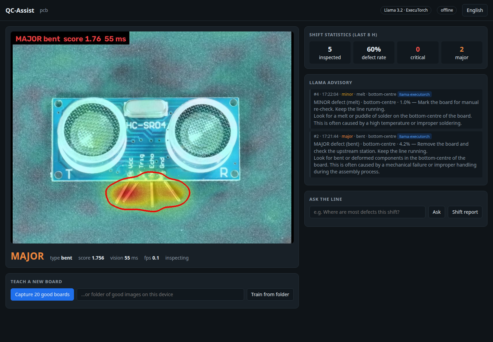

# QC-Assist — On-device PCB Inspection Assistant

**Bharat AI-SoC Challenge 2026–27 · PS5: Real-time industrial defect detection & quality-control assistant**
Theme: Manufacturing & Industry 4.0

QC-Assist inspects printed circuit boards in real time on a Raspberry Pi 5, highlights
defects, rates their severity, and gives the operator advice from **Llama 3.2 1B
running on-device through ExecuTorch** — fully offline, nothing leaves the factory floor.



## Results so far (laptop — Raspberry Pi 5 numbers next)

VisA PCB categories, official one-class split (100 good + 100 defective test boards each),
trained on good boards only. Full JSON: [`results/x86_64/`](results/x86_64/).

| Board | Image AUROC | Pixel AUROC | Defects caught | False alarms | ms / frame (ONNX Runtime) |
|---|---|---|---|---|---|
| pcb1 | 0.972 | 0.996 | 80% | 5% | 39.6 |
| pcb2 | 0.932 | 0.986 | 81% | 5% | 41.9 |
| pcb3 | 0.924 | 0.989 | 53% | 3% | 39.7 |
| pcb4 | 0.990 | 0.985 | 91% | 3% | 39.4 |

Laptop timings are from a shared, busy laptop and vary 33–47 ms per frame between runs.

**On the Hailo NPU (INT8, Dataflow Compiler emulator), all four boards:** image AUROC 0.955 → 0.956
(mean). Quantisation costs no measurable accuracy. Compiled HEFs for Hailo-10H: 3.9–4.4 MB.

**Defect type** (melt, missing, bent, scratch; pcb4: missing, extra, dirt, damage), cross-validated:
88% / 76% / 82% / 69% correct on pcb1–4, against 54% / 55% / 43% / 45% for always guessing the most
common type. When unsure (< 50%) it says "unclassified" instead of guessing.

**Llama 3.2 1B on ExecuTorch (laptop CPU):** 860 MB `.pte`, 1.42 GB RAM, 244 tokens/s prefill,
31 tokens/s decode, defect advice in 2.3 s. Every answer is checked against the facts before
it is shown; 17 of 18 benchmark answers passed, and the one that failed was replaced by correct
deterministic text ([`results/x86_64/llama_VLSI.json`](results/x86_64/llama_VLSI.json)).

## Status (Phase 1)

| Part | State |
|---|---|
| Good-only anomaly detection, severity, defect type, inspection log | working, benchmarked on laptop |
| Operator dashboard (offline), teach a new board from 20 good boards (3 s on the laptop) | working |
| Llama 3.2 1B via ExecuTorch (`TextLLMRunner`, 8da4w, XNNPACK), EN + HI, output checks | working, benchmarked on laptop |
| Hailo: ONNX → INT8 → HEF (DFC 5.4, Hailo-10H), INT8 accuracy in emulator | working; HailoRT run in Phase 2 |
| Raspberry Pi 5 / AI HAT+ 2 runs | pending our hardware |

Phase 1 report: [`docs/technical_report.md`](docs/technical_report.md) (PDF: `python scripts/build_report.py`).
Demo video script: [`docs/demo_script.md`](docs/demo_script.md).

## Why it is different

- **Learns from good boards only.** Show it ~20 defect-free boards and it can inspect
  that product. Factories rarely have labelled defect photos; this needs none.
- **Uses the whole SoC.** Vision runs on the Hailo NPU (AI HAT+) or the Arm CPU;
  Llama runs on the Arm CPU via ExecuTorch (XNNPACK / KleidiAI). Inspection never
  waits for the LLM.
- **Measured, not claimed.** Every number in the report comes from `scripts/evaluate.py`
  and the inspection log.

## Architecture

```
 camera ──► preprocess ──► CNN backbone ──► patch features ──► nearest-normal search ──► anomaly map
                          (Hailo NPU / CPU)                      (Arm CPU, memory bank)        │
                                                                                               ▼
                                         operator UI ◄── severity + location ◄─────────── threshold
                                              ▲                    │
                                              │                    ▼
                         Llama 3.2 1B (ExecuTorch, Arm CPU) ◄── inspection log (SQLite)
                         advice · shift reports · log Q&A        (background worker)
```

The Hailo vision pipeline (HailoRT) and the Llama pipeline (ExecuTorch) are separate,
as the PS5 rules require.

## Repository layout

| Path | What |
|---|---|
| `qc_assist/anomaly.py` | PatchCore-style detector trained on good parts only |
| `qc_assist/severity.py` | anomaly map → severity, defect area, location |
| `qc_assist/defect_types.py` | defect type (missing, melt, bent, ...) from the detector's own features |
| `qc_assist/advisor.py` | Llama advisory via ExecuTorch: plant policy, facts, few-shot prompts, output checks |
| `qc_assist/inspection_log.py` | SQLite log of every inspection |
| `qc_assist/inspector.py` | inspection engine: vision thread, Llama worker, "teach a new board" |
| `qc_assist/dashboard.py` | offline operator web dashboard |
| `scripts/prepare_visa.py` | extract VisA PCB categories into MVTec layout |
| `scripts/train.py` | build a model from good images |
| `scripts/train_types.py` | learn defect types from labelled defect images, cross-validated → JSON |
| `scripts/run_inspection.py` | headless inspection loop on a camera or an image folder |
| `scripts/dashboard.py` | start the operator dashboard |
| `scripts/evaluate.py` | accuracy + latency benchmark → JSON (`--backend torch\|onnx\|hailo\|hailo-emu`) |
| `scripts/export_onnx.py` | export the NPU part to ONNX + Hailo calibration set |
| `scripts/export_llama.py` | export Llama 3.2 1B to ExecuTorch `.pte` (`configs/llama_export.yaml`) |
| `scripts/bench_llama.py` | Llama speed, RAM and output-check pass rate on fixed prompts → JSON |
| `scripts/compile_hailo.sh` | ONNX → INT8 → HEF with the Hailo DFC, then INT8 accuracy in the emulator |
| `docs/executorch_llama.md` | exporting and running Llama 3.2 1B with ExecuTorch |
| `docs/hailo.md` | compiling and running the vision network on the Hailo NPU |
| `configs/default.yaml` | product, detector, severity and Llama settings |
| `scripts/benchmark_all.sh` | train + benchmark all PCB categories, both CPU backends |
| `results/<arch>/` | benchmark JSON per machine (evidence for the report) |
| `docs/technical_report.md` | Phase 1 technical report (draft) |
| `PLAN.md` | Phase 1 plan and deliverables checklist |
| `scripts/demo.py` | demo scenes for the video (`inspect`, `teach`) |
| `scripts/build_report.py` | technical report → PDF |

## Demo

```bash
.venv/bin/python scripts/demo.py inspect   # good + defective boards, types, Llama advice -> http://127.0.0.1:8000
.venv/bin/python scripts/demo.py teach     # new board type with no model: "Train from folder", inspecting in ~3 s
```

## Quick start (laptop)

```bash
python3 -m venv .venv            # or: virtualenv .venv
.venv/bin/pip install torch torchvision --index-url https://download.pytorch.org/whl/cpu
.venv/bin/pip install -r requirements.txt --extra-index-url https://download.pytorch.org/whl/cpu
.venv/bin/pytest -q              # smoke test on synthetic boards
```

Llama 3.2 1B: download, export to `.pte` with `scripts/export_llama.py`, benchmark with
`scripts/bench_llama.py`; see `docs/executorch_llama.md`. Hailo: `docs/hailo.md`.

Get the VisA dataset (CC BY 4.0, 1.9 GB) and convert its PCB categories to MVTec layout:

```bash
mkdir -p data/raw
curl -C - -o data/raw/VisA_20220922.tar https://amazon-visual-anomaly.s3.us-west-2.amazonaws.com/VisA_20220922.tar
curl -o data/raw/visa_1cls.csv https://raw.githubusercontent.com/amazon-science/spot-diff/main/split_csv/1cls.csv
.venv/bin/python -I scripts/prepare_visa.py --tar data/raw/VisA_20220922.tar --csv data/raw/visa_1cls.csv --out data/visa
```

This also writes `data/visa/<board>/defect_labels.csv` (the defect type of every defective test image).

Train, benchmark, inspect:

```bash
.venv/bin/python scripts/train.py --data data/visa/pcb1 --out models/pcb1.pt
.venv/bin/python scripts/train_types.py --model models/pcb1.pt --data data/visa/pcb1   # defect types
.venv/bin/python scripts/evaluate.py --model models/pcb1.pt --data data/visa/pcb1
.venv/bin/python scripts/run_inspection.py --model models/pcb1.pt --source data/visa/pcb1/test
```

Operator dashboard (open http://localhost:8000):

```bash
.venv/bin/python scripts/dashboard.py --source 0 --model models/pcb1.pt                 # camera
.venv/bin/python scripts/dashboard.py --source data/visa/pcb1/test --model models/pcb1.pt --max-fps 2 --loop
```

It shows the live heatmap, the verdict with defect type and latency, Llama advice, shift statistics, a
shift report, questions about the inspection log, an English/Hindi toggle, and **Teach a
new board**, which captures 20 good boards from the camera, trains, and swaps in the new
model without a restart.

Until Llama is configured (see `docs/executorch_llama.md`) the advisor runs a
clearly-labelled rule-based fallback. `--backend onnx|hailo` picks where the CNN runs.

## Hardware

| Part | Role |
|---|---|
| Raspberry Pi 5 (8 GB) | Arm Cortex-A76 CPU: Llama (ExecuTorch), nearest-neighbour search, UI |
| Raspberry Pi AI HAT+ 2 (Hailo-10H) | Hailo NPU: CNN backbone (HailoRT); AI HAT+ (Hailo-8/8L) works with DFC 3.x |
| Camera Module 3 | image capture |

## Datasets and licenses

- VisA — CC BY 4.0 (Zou et al., "SPot-the-Difference Self-supervised Pre-training for Anomaly
  Detection and Segmentation", ECCV 2022); the dashboard screenshot shows a VisA image
- MVTec AD — CC BY-NC-SA 4.0 (non-commercial)
- Llama 3.2 — Llama 3.2 Community License

Datasets and model weights are not committed; see the commands above.
